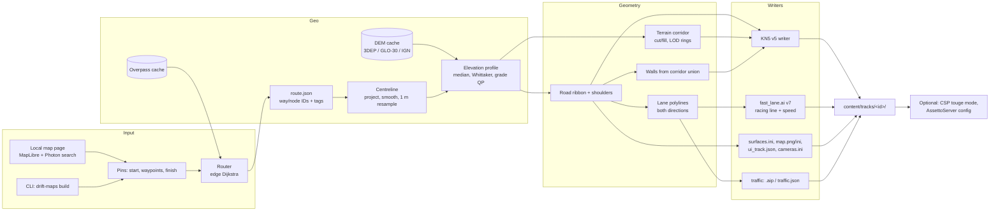

# Drift Maps clone: build plan

*Real roads → Assetto Corsa tracks, with AI line, traffic and touge battles.*

Status: plan v1 (2026-10-14). Written from the brief in [`PLANNING_PROMPT.md`](PLANNING_PROMPT.md)
and four research reports in [`research/`](research/):

| Report | Covers |
|---|---|
| [`research/ac_format.md`](research/ac_format.md) | Track folder layout, KN5 binary format, dummies, surfaces, shaders, limits |
| [`research/ai_line.md`](research/ai_line.md) | `fast_lane.ai` format, generating it in code, racing line + speed profile |
| [`research/bots.md`](research/bots.md) | Traffic (AssettoServer / CSP), touge battle mode, drifting AI |
| [`research/geo.md`](research/geo.md) | OSM + routing, elevation, geometry, Windows packaging, licences |

Those reports hold the field-level detail and source links. Every format claim in them is
marked **VERIFIED** (with source) or **ASSUMED**. This plan summarises their decisions and
turns them into milestones. Where this plan says *spike*, the claim is not yet confirmed in
game and must be tested on the user's PC before we build on it.

---

## 1. Summary

We're building a **local Windows tool**. You pick a start and end point (plus optional
waypoints) on a real road. The tool follows the real road network, takes real elevation,
and writes a driveable Assetto Corsa track straight into `assettocorsa/content/tracks/`.
Every track ships with a **generated AI line**, which gives the ideal-line assist and AI
cars. Later milestones add a **touge battle mode** against an AI car, **two-way traffic**,
a map-picker web page, scenery, and eventually an Initial D-style **drifting AI**.

### Key decisions

| # | Decision | Why |
|---|---|---|
| D1 | **Local tool first.** A Python library + CLI, then a local web map picker. A hosted site comes later, if ever. | User's choice. No server, accounts or costs, and it's the fastest way to drive a generated road. |
| D2 | **Write KN5 files directly from Python (format v5).** No Blender, FBX or ksEditor at build time. | The format is small and fully known from Content Manager's own source (`AcTools/Kn5File/Kn5Writer.cs`). At least four projects write KN5 from scratch, two confirmed in game. Our spike writer round-trips through an independent parser. Fallback: FBX → `ksEditorAt.exe kn5track` on Windows. |
| D3 | **Generate `fast_lane.ai` in code** (format v7, all 18 payload fields filled). | The format is known byte for byte from AcTools + AssettoServer. Several tools already generate it. No game is needed at build time. Fallback: record in game (steps in `ai_line.md` §3). |
| D4 | **Our own deterministic router** over cached Overpass data (edge-based Dijkstra, no U-turns). The preview writes `route.json`, and the build reads it and never re-routes. | No routing server, full OSM tags per edge, and the preview always matches the build. |
| D5 | **Elevation:** USGS 3DEP (US, 1 m lidar first), Copernicus GLO-30 elsewhere, IGN RGE ALTI/LiDAR HD for France. Robust smoothing with hard grade limits. | All free and public. GLO-30 is a surface model (it includes trees), so it needs filtering. |
| D6 | **AC coordinate frame: X = east, Y = up, Z = south** (right-handed). | Confirmed in game by one project (AutoX generator). The wrong sign mirrors the track and breaks timing gates. Spike S4 re-checks it. |
| D7 | **The A→B track works in vanilla AC** (practice, hotlap, time attack, drift, ideal line). **AI races and traffic use CSP / AssettoServer.** | Vanilla AI doesn't handle point-to-point finishes. CSP Lua and AssettoServer have everything needed (see §5.8). |
| D8 | **Python 3.12**, numpy/scipy/shapely/pyproj/rasterio, Typer CLI, FastAPI + MapLibre UI, OpenFreeMap dark tiles. | All have Windows wheels. 3.12 is the floor for current rasterio/pyproj/scipy. OpenFreeMap needs no key (CARTO now needs one). |
| D9 | **Free, personal project.** No payments or tiers. | User's choice. |

---

## 2. Architecture



The pipeline is a chain of pure steps with cached intermediates, so changing a smoothing
parameter re-runs only the later steps:

`pins → route.json → centreline.npz → profile.npz → meshes.npz → lanes.npz → track folder (+ zip)`

---

## 3. Tech stack

| Area | Choice | Notes |
|---|---|---|
| Language | Python 3.12 | `uv` for env + lock file |
| Numerics / geometry | numpy, scipy (cKDTree, sparse, optimisation), shapely 2.x, OSQP | **Don't use `triangle`** (non-commercial licence). Use mapbox-earcut for polygon fills. |
| Projection | pyproj: custom Transverse Mercator, origin at the start pin | Scale error ~5 ppm at 20 km |
| DEM I/O | rasterio windowed reads of COGs over HTTP (`/vsicurl/`) | 3DEP on `prd-tnm` S3, GLO-30 on `copernicus-dem-30m` S3, no auth |
| OSM | Overpass API (corridor `poly:` query, `out tags geom`), mirror list, disk cache | Optional offline mode later: Geofabrik `.pbf` + pyosmium |
| Debug export | trimesh → GLB/OBJ | View meshes without launching AC |
| Images | Pillow (PNG, BC1/BC3 DDS) | Mipmaps: our own downsample chain, or texconv as an optional dev tool |
| CLI | Typer | `drift-maps build / route / preview / install / doctor` |
| Local UI | FastAPI + uvicorn, MapLibre GL JS, OpenFreeMap dark style, Photon geocoder | Served on `localhost`, opens in the browser |
| Packaging | `uv tool install` / pipx first, PyInstaller one-folder exe later | |
| Tests | pytest, hypothesis (geometry), golden files | Independent KN5/AI parsers in the test suite |
| Bot-car runtime | CSP Lua New Mode (touge), AssettoServer config generation (traffic) | Lua lives in `csp/`. The server is the user's own install. |

---

## 4. Repository layout

```
MapsAssetoCorsa/
├── pyproject.toml
├── src/driftmaps/
│   ├── cli.py                 # Typer entry point
│   ├── config.py              # AC path discovery (flag → Steam libraryfolders.vdf → CM hint)
│   ├── pipeline.py            # step orchestration + cache fingerprints
│   ├── geo/
│   │   ├── overpass.py        # corridor query, mirrors, retries, cache
│   │   ├── graph.py           # unsimplified edge graph with tags
│   │   ├── router.py          # snapping, waypoint-layered edge Dijkstra → route.json
│   │   ├── project.py         # local tmerc, ENU ↔ AC axes
│   │   └── attributes.py      # width / lanes / surface / bridge / tunnel / driving side
│   ├── elevation/
│   │   ├── sources.py         # 3DEP, GLO-30, IGN, fallbacks; tile cache
│   │   └── profile.py         # 1 m sampling, cross-road median, Whittaker, grade QP
│   ├── geometry/
│   │   ├── centreline.py      # fillets, smoothing, resampling, frames (tangent/normal)
│   │   ├── road.py            # ribbon, shoulders, camber, UVs, chunking ≤ 65,535 verts
│   │   ├── terrain.py         # corridor heightfield, cut/fill, LOD rings, skirts
│   │   ├── walls.py           # corridor union boundary → hidden walls
│   │   └── lanes.py           # per-lane polylines both directions
│   ├── ac/
│   │   ├── kn5.py             # KN5 v5 writer (+ reader for tests)
│   │   ├── textures.py        # PNG/DDS + mips
│   │   ├── ai_line.py         # fast_lane.ai v7 writer/reader, racing line, speed profile
│   │   ├── track_files.py     # surfaces.ini, map.png/ini, cameras.ini, ui_track.json, previews
│   │   ├── dummies.py         # AC_START/PIT/HOTLAP/AB gates placement
│   │   └── traffic.py         # AssettoServer .aip/config, CSP traffic.json
│   ├── web/                   # FastAPI app + static MapLibre page
│   └── assets/textures/       # CC0 textures (ambientCG / Poly Haven) + CREDITS
├── csp/new-modes/touge-battle/  # Lua New Mode (manifest.ini, mode.lua)
├── tools/                     # ai_dump.py, kn5_dump.py, spike scripts
├── tests/
└── docs/  (PLAN.md, research/, LICENSES.md, in-game test checklists)
```

---

## 5. Detailed design

### 5.1 Road data and routing (`geo/`)
- **Fetch:** an Overpass corridor query around the straight-line chain of pins (buffer ~2–5 km,
  widened if routing fails). Filter: `highway` in drivable classes. Output `out tags geom`.
  Cache by query hash + snapshot timestamp. Use a mirror list with exponential backoff, because
  the sandbox test got a 504.
- **Graph:** one directed edge per consecutive OSM node pair, keeping `way_id` and all tags.
  Don't simplify. Ignore `oneway` (it's a race track), but keep it as a soft cost option.
- **Snap:** each pin goes to the nearest edge (projected point). This splits the edge virtually.
- **Route:** edge-based Dijkstra layered by waypoint (state = edge, waypoint index). A turn cost
  forbids U-turns and penalises sharp junction turns. Integer costs and fixed tie-breaks make
  it deterministic.
- **Output `route.json`:** snapshot time, snapped pins, ordered directed edges `(way, from, to)`,
  per-edge tags, length. **Reverse** = reverse the edge list. **The build reads only `route.json`.**
- **Attributes:** width from `width`, then `lanes × lane_width`, then a per-`highway` default
  table. Also surface (asphalt/gravel), `bridge`/`tunnel`/`layer`, and driving side per country
  (left in JP/UK/AU…).
- **Limits:** v1 max route 25 km (configurable). Warn when a route crosses itself.

### 5.2 Elevation (`elevation/`)
- **Source chain:**
  - US: 3DEP 1 m project DEM (TNM Access API) → S1M seamless 1 m → 1/3″ seamless.
  - France: IGN RGE ALTI / LiDAR HD (Géoplateforme, ≤5 req/s).
  - Elsewhere: Copernicus GLO-30.
  - Fallbacks: AWS Terrain Tiles, OpenTopography (user-supplied key).
- **Profile:**
  1. Sample every 1 m along the centreline. At each station take the median of samples across the road width.
  2. Give bridges and tunnels weight 0, so they're interpolated straight instead of following the ground.
  3. Apply an asymmetric Whittaker smoother, which rejects DSM tree/building spikes (they bias upward).
  4. Solve a QP (OSQP) with hard limits: grade ≤ 20% (configurable) and vertical curvature ≤ a set limit.
- **Terrain:** a separate corridor heightfield from the raw DEM, then cut/fill blending toward
  the road edges with a slope clamp per road "leg". Hairpins are handled by computing per leg
  and taking the max/min properly. Triangles under the road are removed, and the verges get skirts.

### 5.3 Geometry (`geometry/`)
- **Projection:** pyproj tmerc with the origin at the start. AC position = `(E, U, −N)` (D6).
- **Centreline:** fillet junction kinks, run a curvature-regularised smoother (Whittaker on x(s), y(s)) with
  a max-deviation tolerance from OSM, resample to 1 m, then compute tangent/normal frames.
- **Road ribbon:**
  - Carriageway width from attributes, plus shoulders (gravel, physical) and optional camber.
  - Longitudinal tessellation ~1 m (spike S15 checks smoothness).
  - UVs tile along the road distance.
- **Chunking:** ≤ 65,535 vertices per mesh (16-bit indices) and ~200–500 m road chunks
  (`1ROAD_c###`), for culling and the KN5 limit.
- **Terrain:** a regular grid with LOD rings. The near ring is physical (`1GRASS_t###`). Far rings
  are visual only, with `lodOut` and `castShadows=false`.
- **Walls:** the boundary of `unary_union(buffer(leg, half_width + shoulder + verge))`, extruded
  2–3 m, as hidden meshes `1WALL_*` (`isRenderable=false`). Hairpin legs merge, so walls never
  cut across the road. There's also a far world-boundary wall.
- **Lanes:** per-lane polylines in both directions, at ±lane offsets on the correct driving side.
  They're stored as an intermediate (`lanes.npz`) that feeds the AI line, AssettoServer splines
  and CSP `traffic.json`.

### 5.4 Track files (`ac/`)
Full field lists are in `research/ac_format.md`. What we write:

- **`<id>.kn5` (v5):** root dummy (identity) → road chunks, shoulders, near terrain, far terrain,
  hidden walls, and all `AC_*` dummies **as direct children of the root**. World-space vertices,
  one material per mesh. If the file gets large, split terrain into `<id>_terrain.kn5` through
  `models.ini` (spike S8).
- **Materials (v1):** `ksPerPixel` + one diffuse texture each (road, gravel, grass, a hidden
  wall material). Later: `ksPerPixelNM` road, `ksMultilayer` terrain.
- **Textures:** DDS BC1/BC3 with mips (vanilla-safe). PNG is allowed for M0 only (spike S2).
- **Dummies:**
  - `AC_PIT_0..N`: N = 24–40, because AssettoServer needs a pit box per traffic slot.
  - `AC_START_0/1` side by side at A, then a grid behind them.
  - `AC_HOTLAP_START_0` behind A.
  - Gates `AC_AB_START_L/R`, `AC_AB_FINISH_L/R`, optional splits `AC_TIME_n_L/R`. `_L` must be on the driver's left.
  - Spawn orientation: local +Z along the road.
  - Spawn height and direction are both decided by spike S5.
- **Data files:**
  - `data/surfaces.ini`: ROAD, GRAVEL, GRASS.
  - `data/map.ini` + `map.png`: north-up, formula from CM source.
  - Also `data/cameras.ini`, `data/groove.ini`, `data/crew.ini`, and optionally `data/lighting.ini`.
- **UI:**
  - `ui/ui_track.json`: name, length, `geotags`, country, `pitboxes`, tags (`touge`, `point-to-point`, and later `traffic-planner-ready`), and attribution.
  - `ui/preview.png` and `ui/outline.png`.
- **Credits:** `route_osm.geojson` and `LICENSE-DATA.txt` in every track (ODbL + DEM attribution, see §5.10).
- **CSP-extended variant (optional, later):** a separate layout with `extended-0` surfaces and
  scripting permissions. It's CSP-only, so it's never the default layout.

### 5.5 AI line (`ac/ai_line.py`)
Details are in `research/ai_line.md`.
- **Format v7:**
  - Header `version, N, lapTime, sampleCount`.
  - N × `{x, y, z, cumulativeLength, id}`.
  - `N` × 18 floats: speed, gas, brake, obsoleteLatG, radius, sideLeft, sideRight, camber, direction, normal xyz, length, forward xyz, tag, grade.
  - `hasGrid = 0`.
- **Racing line:** a minimum-curvature lateral offset within (half-width − margin), using bounded
  least squares with 2–3 re-linearisations.
- **Speed profile:** a forward–backward pass on a friction circle with grade and banking terms.
  Generic μ ≈ 1.0 and a top-speed cap. Also gives gas and brake.
- **Every field filled:** sides = road edges − margin, radius from curvature (never 0, because
  AssettoServer uses it for corner speed), plus normals, forward, grade and camber.
- **Extend the line 150–300 m past B** into a run-off, so AI doesn't brake for a wall.
- **Also write `data/ideal_line.ai`** (a copy). Skip `pit_lane.ai` unless spike S7 says it's needed.
- **Units:** spike S0 dumps Kunos tracks to settle speed, camber and grade units *before* M2.
- **Fallback:** the CSP AI Spline Editor to hand-fix the line, or in-game recording (`ai_line.md` §3).

### 5.6 Touge battle (`csp/new-modes/touge-battle/`)
- A **CSP New Mode** (Lua) on public CSP 0.2.11+ with one AC AI opponent on our `fast_lane.ai`.
- Lua handles:
  - countdown and side-by-side or rolling start;
  - Initial D rules (lead/chase rounds, gap at the finish, overtake = win);
  - finish detection at gate B, then stopping or teleporting cars;
  - results.
- **AI tuning API** (real names confirmed in the CSP SDK): `physics.setAILevel`, `setAIAggression`,
  `setExtraAIGrip`, `setAITopSpeed`, `setAIStopCounter`, `setAICarPosition`, `setAINoInput`, `setAISpline`.
  (`physics.setAIPedals` and `setAISteer` do **not** exist.)
- Only tracks tagged `touge` are allowed. Base mode `RACE` (also try `TRACK_DAY`), `AI_LIMIT=1`.
- No offline touge-vs-AI mode exists publicly yet, so this is genuinely new.

### 5.7 Traffic (`ac/traffic.py`)
All three options come from the same `lanes.npz`:
1. **AssettoServer (main path, Shutoko style):**
   - What we write: one spline per lane per direction (AssettoServer's simple v −1 format: position, radius, camber per point), zipped as `fast_lane.aip` + `config.yml` with `ConnectEnd` joining opposite lanes at A and B so cars U-turn.
   - Plus `extra_cfg.yml` (`EnableAi: true`, `TwoWayTraffic: true`, `LaneWidthMeters`), `entry_list.ini` with `AI=fixed` slots ≤ pit count, and `server_cfg.ini`.
   - The user runs AssettoServer locally and joins from CM's LAN tab. `drift-maps serve` can launch it.
2. **CSP Traffic mode (offline):** `traffic.json` of directional 3D lane polylines, plus the
   `traffic-planner-ready` tag and an `extended-0` layout. It's CSP-only and needs CSP's traffic car download.
3. **CSP AI Flood (free fallback):** Track Day with N AI on `fast_lane.ai`, one direction only,
   with zero extra data. The user has to lower CSP's "minimum track length" setting (default 7 km).

### 5.8 Drifting AI (stretch goal)
No public drift AI exists for AC. Staged options:
- **(a) Replay ghost rival:** CSP 0.3.0-preview "Revenant" mode plays back a recorded human drift run, with
  collisions. Feasible now, but needs the Patreon preview.
- **(b) Lua drift controller** in our New Mode:
  - Steering is fully overridable (`physics.overrideSteering`).
  - Throttle is combined with the AI's own via `max()`, so spike S4 must find a way to zero the AI's pedals.
  - A PID / cascaded controller on body slip angle follows a "drift line" (the racing line pushed wide).
- **(c) External controller** through CSP's Custom AI shared-memory interface: full controls at 333 Hz plus slip
  telemetry. Needs a helper exe and track permission `ALLOW_CUSTOM_AI_MANIPULATION=1`.

Rating: (a) feasible, (b) hard, (c) research project. A time-boxed spike runs before committing.

### 5.9 Local tool UX (`cli.py`, `web/`)
- `drift-maps build --start LAT,LON --end LAT,LON [--via LAT,LON]... --name "Test" [--reverse]`
- `drift-maps route ...` writes `route.json` only. `drift-maps build --route route.json` builds from it.
- `drift-maps ui` opens the local map page:
  - search (Photon), click pins (green start, amber waypoints, red finish);
  - drag, Undo last, Reverse, Clear;
  - live route length;
  - **Build this track**, with progress shown in the page.
- `drift-maps doctor` checks the AC path, CSP version, write permission and network access.
- **AC path discovery:** CLI flag / config → Steam registry → `libraryfolders.vdf` →
  `appmanifest_244210.acf`. Content Manager's `_ac_root` is a hint only.
- Output goes to `content/tracks/dm_<slug>/`, also zipped for sharing. Content Manager picks it up after a refresh.

### 5.10 Legal and attribution
- **OSM (ODbL):** treat each track as a *Produced Work*. Put "© OpenStreetMap contributors, ODbL"
  in `ui_track.json`, `LICENSE-DATA.txt` and the UI. Ship `route_osm.geojson` to cover
  share-alike cheaply. (This is an interpretation, not legal advice.)
- **DEMs:** USGS is public domain. Copernicus needs the exact WorldDEM-30 notice and the
  liability sentence (copied in `research/geo.md` §6). IGN uses Licence Ouverte (credit IGN).
- **Kunos:** a compatibility statement only ("not affiliated with or endorsed by Kunos
  Simulazioni"). Never ship game files, textures or shaders from AC.
- **Code reuse:**
  - AcTools (MS-PL) and KinG-InFeT (Apache-2.0) can be ported with credit.
  - GPL-3 projects (moppius, nazariyKul, JostMK) are for reference and dev-time test oracles only. They never ship.
  - Unlicensed repos (Hemphill39 AutoX, MarvinSt/RaduMC): read only, copy nothing.
- **Textures:** ambientCG and Poly Haven (CC0).
- **Map tiles:** OpenFreeMap (no key), or CARTO only with the user's own key.

---

## 6. Milestones

Each milestone ends with something you can drive. "In-game check" means a test on the user's
PC using a checklist in `docs/checklists/`.

### M0: KN5 spike (prove AC loads our files)
- A clean KN5 v5 writer + reader in `ac/kn5.py`, built from the spike in `research/spikes/`.
- A `drift-maps spike` command writes test tracks for in-game checks S1–S9 from `ac_format.md` §0.1:
  - flat strip;
  - DDS vs PNG;
  - hidden walls;
  - **L-shaped road for handedness**;
  - spawn heights;
  - **A→B gates**;
  - `models.ini` chunks;
  - 65,535-vertex mesh;
  - unknown dummy names.
- `tools/ai_dump.py`, plus **AI spike S0**: dump Kunos `fast_lane.ai` files to settle units.
- **Acceptance:** all M0 tracks show up in Content Manager and load in Practice. The car sits
  on the road facing forward. The A→B timer starts and stops. Hidden walls collide.
  The handedness and spawn rules are written down as VERIFIED in `docs/`.

### M1: First real track (road + real elevation + terrain + walls)
- Overpass + router + `route.json`, centreline, elevation profile, road ribbon, terrain,
  walls, dummies, surfaces, map, UI files, attribution. A CLI build of a full track folder.
- **Test routes:**
  1. Aurora, IL, 3.6 km (`41.71712,-88.29689 → 41.72328,-88.27246`, 3DEP).
  2. Gorges d'Ollioules, D N8, France (GLO-30 and IGN).
  3. One Japanese touge (left-hand traffic, steep): Akina / Mt. Haruna.
- **Acceptance:**
  - All three load and drive end to end without falling through, invisible bumps or mirrored turns.
  - Elevation matches the real road within ~2 m RMS against lidar where available.
  - Builds in < 2 minutes per 5 km on the user's PC (data cached).

### M2: AI line (ideal line + AI can drive the road)
- `fast_lane.ai` + `ideal_line.ai` generation, racing line and speed profile.
- In-game spikes S1–S9 from `ai_line.md`: round-trip, CSP on/off, no-grid, sides, point-to-point
  session matrix, whether `pit_lane.ai` is needed, AI quality, speed-field effect.
- **Acceptance:**
  - The ideal line is drawn along the road.
  - One AI car completes the 3–5 km test route 3 out of 5 times at 90% strength without leaving the road.
  - Works with CSP. Vanilla loads without crashing (or a grid is generated).

### M3: Touge battle v1 (grip AI)
- The CSP New Mode from §5.6, plus generator support: side-by-side `AC_START_0/1`, a run-off
  past B, and the `touge` tag.
- **Acceptance:** race one AI car from A to B. The AI doesn't stop before B, the mode declares
  a winner, and it works on public CSP 0.2.11.

### M4: Traffic
- First AssettoServer two-way traffic (bots spike S1), then the CSP `traffic.json` variant (S2).
- `drift-maps serve` writes the server configs and starts the user's AssettoServer.
- **Acceptance:** two-way traffic flows on the test route and U-turns at the ends. Nothing floats or
  sinks, and joining from CM's LAN tab works.

### M5: Local map picker
- `drift-maps ui` with the §5.9 page. The preview and the build share `route.json`.
- **Acceptance:** pick → preview → build → drive with no terminal. The preview length matches the built track length.

### M6: Scenery
- Trees from OSM `landuse=forest`/`natural=wood` (CSP tree lists, plus a vanilla fallback of
  instanced billboards), grass FX, buildings from footprints (extruded), better road materials
  (normal map, edge lines), and a horizon backdrop.
- **Acceptance:** looks recognisably like the real place in a side-by-side comparison, with FPS within budget (S12).

### Stretch: Drifting AI
- Spikes S4–S7 from `research/bots.md`: can Lua fully drive an AI car, Custom AI external control,
  skidpad drift controller, Revenant ghost.
- **Acceptance (first gate):** hold a 25° drift ±5° for 3 s on a skidpad. Then one hairpin
  sideways without spinning in 8 of 10 runs.

### Later: hosted website
Accounts, "Your builds", build queue, email delivery. Only if wanted. Because the build runs on
Linux with no game, the same library can run on a cheap worker.

---

## 7. Testing strategy
- **Unit tests:**
  - projection round-trips;
  - router determinism (same input → identical `route.json` bytes);
  - centreline smoothness (curvature bounds);
  - profile constraints (grade and vertical-curvature limits hold);
  - mesh invariants (no NaNs, consistent winding, ≤ 65,535 verts per mesh).
- **Format round-trips:** our KN5 writer → our reader **and** an independent parser (dev-only GPL
  oracle, not shipped). Our AI writer must be byte-identical when rewriting a Kunos `fast_lane.ai` (spike S1).
- **Golden files:** small fixed routes with cached Overpass and DEM snapshots in `tests/fixtures/`. A
  full build is compared against stored hashes and summary stats.
- **Visual debug:** every build can also export a GLB, plus a PNG plot of the route, profile and AI speed.
- **In-game checklists** (`docs/checklists/M*.md`): the manual steps for the user on Windows, with
  `Documents\Assetto Corsa\logs\log.txt` as the first place to look when something fails.

---

## 8. Risks (ranked) and fallbacks

| # | Risk | Impact | Fallback |
|---|---|---|---|
| 1 | AI on point-to-point tracks misbehaves (stops at or crashes into the finish, race won't end) | Touge battles | Run-off + AI line past B, our Lua mode controls the finish, or an out-and-back loop layout |
| 2 | Generated `fast_lane.ai` rejected by vanilla AC (no grid) or AI drives badly | AI line, bots | Generate the lookup grid (structure known). Tune the payload. CSP AI Spline Editor / in-game recording. |
| 3 | KN5 detail wrong (handedness, flags, spawn height, PNG mips) | Everything | M0 spikes come first. FBX → `ksEditorAt kn5track` on Windows as a last resort. |
| 4 | DSM noise (GLO-30 trees and buildings) makes bumpy roads outside US/FR | Driveability | Asymmetric smoothing + QP limits. National lidar adapters. A manual "flatten" factor. |
| 5 | Overpass unreliable or rate-limited | Builds fail | Mirrors, backoff, cache. Offline `.pbf` mode. |
| 6 | Performance on long routes (10–25 km) | FPS / load time | LOD rings, chunking, `models.ini` split, cap terrain width |
| 7 | Lua can't fully drive an AI car's pedals | Drifting AI | Custom AI external controller, or Revenant ghost |
| 8 | CSP Traffic Planner format changes (experimental) | CSP traffic | Prefer AssettoServer. Pin the CSP version in docs. |
| 9 | Licence mistakes (ODbL, Copernicus, GPL code) | Sharing tracks | Attribution in every track. No GPL or unlicensed code shipped. |

---

## 9. Very first steps (for the implementation session)

1. Scaffold the repo: `pyproject.toml` (Python 3.12, uv), `src/driftmaps/`, Typer CLI stub, pytest, ruff.
2. Port the KN5 spike (`docs/research/spikes/kn5_spike.py`) into `ac/kn5.py` as a proper
   writer + reader (dataclasses for textures, materials, nodes, meshes), with round-trip tests.
3. Write `ac/track_files.py` minimal outputs: `surfaces.ini`, `ui_track.json`, `map.ini` + `map.png`.
4. Build `drift-maps spike` to output the M0 test tracks (flat strip, L-road, walls, gates,
   spawn heights, DDS/PNG, chunks, big mesh, unknown dummies) into a chosen `content/tracks` folder.
5. Write `tools/ai_dump.py` and `ac/ai_line.py` reader/writer (v7), with a round-trip test on a sample file.
6. Write `docs/checklists/M0.md`: exact in-game steps for the user (Content Manager → Drive →
   track → Practice), what to look for, and what to report back (screenshots + `log.txt`).
7. **User runs the M0 checklist** and AI spike S0 on their PC. Update the ASSUMED items in `docs/` with the results.
8. Start M1: Overpass client + cache, then the router, then `route.json` for the Aurora test route.
